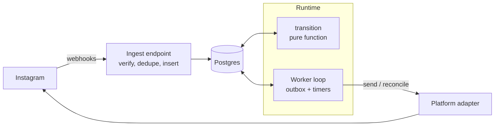
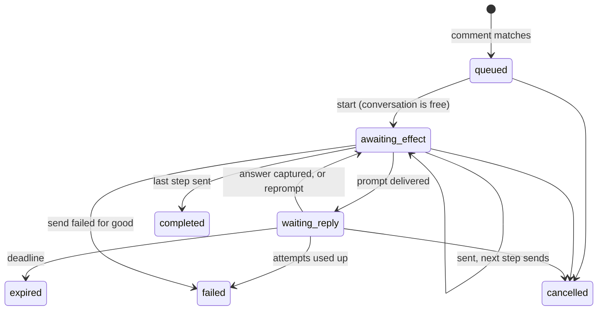

# Comment-triggered automations: backend design

A design for automations that start when someone comments on a social post, with a small reference implementation of the parts where the reasoning is easiest to get wrong.

> When someone comments "pricing" on any Instagram post: reply "Sent you a DM!", DM them asking for their email, wait for the answer, then DM a link.

**What is in this repo**

| | |
|---|---|
| This file | The design: architecture, data model, execution model, reliability, concurrency |
| [`docs/failure-modes.md`](docs/failure-modes.md) | Every failure and race I could think of, what the system does, and the test that proves it |
| [`docs/capacity.md`](docs/capacity.md) | Load estimates by stage, spikes, and what changes when |
| [`src/`](src) | About 1,500 lines of TypeScript: the pure engine, the Postgres schema and store, the runtime |
| [`test/`](test) | Unit, property, scenario, simulation and real-Postgres concurrency tests |
| [`AI-USAGE.md`](AI-USAGE.md) | What I did myself and where I used AI |

The brief asks for a design, not code. I wrote code anyway for one reason: claims like "a reply racing a timeout is safe" are cheap to write and easy to get wrong, so the claims in this document that can be tested are tested. The HTTP layer, the Instagram client and the UI are assumed to exist, as the brief allows.

```bash
npm install
npm test                      # everything that does not need a database
docker compose up -d          # Postgres 15 on localhost:54329
DATABASE_URL=postgres://postgres@localhost:54329/automations_test npm test
```

## 1. What is actually hard here

Running four steps in order is not the hard part. Two facts about the platform are, and the design is organised around them.

**An inbound DM carries no correlation ID.** The webhook says "account A received text T from user U". Nothing ties it to the automation that asked the question. So the link between a reply and a waiting run has to be inferred, and the inference breaks whenever two runs could plausibly own the same reply, when the reply arrives before we have recorded that we are waiting, or after we gave up.

**Sending is not idempotent.** The send endpoint takes no idempotency key. A call that times out, or a worker that dies between the call and the commit, leaves us not knowing whether the commenter got the message. Retrying may send twice. Not retrying may send nothing. No amount of careful queueing removes that choice; it can only be made deliberately, per kind of message.

Everything else (durable waits, retries, webhook redelivery) is ordinary and solved with ordinary tools.

## 2. Decisions at a glance

| Decision | Chosen | Rejected | Why |
|---|---|---|---|
| Where state lives | Postgres only | Temporal, SQS + DynamoDB, Redis queues | The stack is already Postgres on Heroku and the team is small. A run is a row; a transition and its outgoing message commit in one transaction, which is the property the other options make you rebuild. See [capacity](docs/capacity.md) for when this stops being true. |
| Execution model | Explicit state machine, pure `transition(run, event)` | Workflow-as-code with replay (Temporal style) | A run here is a short linear program that mostly waits. Replay buys arbitrary code in workflows at the cost of determinism rules and versioning pain. A pure function over data is testable exhaustively and readable in one sitting. |
| Unit of concurrency | The conversation: (account, contact) | Per-run row locks, optimistic versioning | Replies are addressed to a conversation, not a run, so that is where exclusion has to be. One lock, taken first, serialises triggers, replies, send results and timers. |
| Who owns a reply | At most one active run per conversation; others queue | Fan the reply out to every waiting run; "most recent prompt wins" | Fan-out makes one message answer two different questions. "Most recent wins" silently starves the older run. Queueing is the only option where the commenter's experience is a normal conversation. |
| Delivery guarantee | Chosen per message kind (section 6) | One global at-least-once or at-most-once | A duplicate public comment and a duplicate DM with a link are not the same cost. |
| Definition format | Versioned JSON document, linear steps | DAG / visual-builder graph, embedded scripting | Linear covers the product today. The JSON is small enough for a customer's agent to author over the API, and validated hard enough that an invalid program is rejected at publish, not at 3am. |
| Prompt + wait | One `ask` step | Separate `send_dm` and `wait` steps, as the brief lists them | A wait with no question has nothing to correlate a reply with, and "skip if we already know their email" must skip the question too (section 3). |

## 3. The automation model, and how general it is

An automation is a trigger and an ordered list of steps ([`examples/pricing.json`](examples/pricing.json)):

```json
{
  "trigger": { "type": "comment_keyword", "platform": "instagram",
               "keywords": ["pricing"], "match": "contains", "postIds": "any" },
  "steps": [
    { "type": "reply_to_comment", "text": "Sent you a DM!" },
    { "type": "ask", "prompt": "What's the best email to send it to?",
      "capture": "email", "saveAs": "email", "timeoutSeconds": 82800,
      "maxAttempts": 3, "repromptText": "I couldn't spot an email in that. Could you send it again?",
      "skipIfKnown": true },
    { "type": "send_dm", "text": "Thanks! Here is the link: https://example.com/pricing" }
  ]
}
```

Three step types: `reply_to_comment`, `send_dm`, `ask`. That is deliberately all.

**How general I made it, and why.** General enough that the next ten automations a customer asks for are new JSON, not new code: different keywords, different texts, several questions in a row, captured fields reused in later messages (`{{email}}`). Not general enough to be a workflow product: no branching, no delays, no HTTP steps, no scripting. Each of those is a real feature with its own failure modes, and none is needed to ship the example. The extension points are already in the shape of the code:

- A new step type is one case in `advance()` in the engine and one schema entry.
- A new trigger (story reply, new follower) is a new `matchesTrigger` variant; runs do not care what started them.
- Branching would replace "next step is `i + 1`" with a `next` field. The run already stores a step index, so in-flight runs survive that change.

**Definitions are data, and are checked like programs.** Instagram allows one *private reply* per comment (a DM addressed by comment ID), and ordinary DMs only after the person has written back. So `[send_dm, send_dm]` can never work: the second message would be rejected by the platform. The validator runs a small abstract interpretation over the steps, tracking the reachable set of `(privateReplyUsed, windowOpen)` states and forking at every `ask` that may be skipped. A definition is accepted only if no path needs a second private reply. A property test then checks the engine against the validator: for any accepted definition and any event sequence, the engine never emits a second private reply.

This is also why `ask` is one step. In the first draft the question and the wait were separate, and `skipIfKnown` on the wait meant the question was still sent, used up the one private reply, and the link could never be delivered. Merging them removed the bug by construction.

**Versions are immutable.** Editing an automation publishes a new version. A run is pinned to the version it started on, so an edit can never move the step index of a running conversation onto a different step.

## 4. Architecture



- **Ingest** does the minimum inside the webhook request: record the event ID (redeliveries stop here), find matching automations, create runs. One transaction, then 200.
- **`transition`** is the whole behaviour of a run: `(definition, run, event, now) → (run', effect?)`. It performs no I/O, never throws, and returns the same run untouched for any event that does not apply. That last property is what makes duplicates and late arrivals harmless.
- **The worker** claims due messages from the outbox with `FOR UPDATE SKIP LOCKED`, calls the platform with no transaction open, records the result, and feeds it back to the run as an event. It also fires due timers.
- **The adapter** is the seam to the existing sending code: `send(effect)` and `reconcile(effect)`.

Any number of web and worker dynos can run this; nothing is held in process memory between transactions.

## 5. Data model

Full DDL with a comment on every index: [`src/store/schema.sql`](src/store/schema.sql).

| Table | What it holds | Invariant enforced by the database |
|---|---|---|
| `automation_versions` | Immutable published definitions | |
| `inbound_events` | Webhook event IDs already processed | Primary key: a redelivery inserts nothing |
| `runs` | One execution for one commenter: status, step index, captured fields, deadline | Unique `(automation, trigger comment)`: a comment starts an automation once. Partial unique `(account, contact)` where status is active: **one owner per conversation** |
| `messages` | Every inbound DM, with which run consumed it (or none) | Primary key on the platform message ID |
| `effects` | The outbox and the permanent ledger of every send | Primary key is the idempotency key `run:step:attempt` |
| `account_throttles` | "Do not send for this account before T" | |
| `leads` | Captured fields per contact (PII) | |
| `run_log` | Append-only story of each run | |

The application takes a lock before it relies on any of these invariants. The indexes are the backstop for the day someone writes a code path that forgets to, and there is a test that skips the lock on purpose and checks that the index catches it.

`run_log` exists because the first support question for this feature will be "why didn't it fire for this comment?", and the answer should be a query, not an investigation.

## 6. Execution model



**One transaction per event.** Lock the conversation, load the run, apply `transition`, save the run, append the log, insert the outgoing message into the outbox, commit. The state change and the intent to send are atomic. The send itself happens later, outside any transaction, so a slow platform never holds a database lock.

**One message in flight per run.** The engine emits at most one effect per transition and the run waits for its result. Steps therefore execute strictly in order, and "which send failed" is never ambiguous.

**Waiting costs nothing.** A waiting run is a row with a `wake_at`. There is no process, timer or connection per run. A reply and a timeout are two events through the same locked transition: whichever commits first moves the run, and the other finds a run it no longer applies to and does nothing.

**Correlating replies.** Every inbound DM is stored first, unconsumed. If the conversation has an active run that is waiting, it consumes the message. If the run is not waiting yet (the person answered faster than the platform acknowledged our question), the message stays unconsumed, and the moment the run enters `waiting_reply` it drains unconsumed messages received since it started. Arrival order stops mattering. If no run owns the conversation, the message is left for the human inbox.

**A second automation for the same person** is created `queued`. When the owner finishes, the next queued run is promoted in the same transaction. If it would ask for something we now know, `skipIfKnown` skips the question and its link goes out as that comment's private reply. The commenter is asked for their email once.

**Delivery policy per message kind.** When the outcome of a send is unknown:

| Message | Policy | Behaviour | Reason |
|---|---|---|---|
| Private reply (first DM) | `retry_safe` | Retry. "Already replied to this comment" counts as success. | The platform allows exactly one per comment, so it deduplicates for us. |
| Public comment reply | `at_most_once` | Never blindly retried. Reconcile against the platform; if still unknown, assume sent. | Two identical public replies look broken to everyone reading the post. A missing "Sent you a DM!" costs nothing. |
| Later DMs (the link) | `at_least_once` | Retry with backoff. | A duplicate link is a small annoyance. A lead who gave their email and got nothing is a lost customer. |

The system is therefore honest about being at-least-once for the link, and there is a test that asserts the duplicate rather than pretending it cannot happen. Removing it for real needs either an idempotency key from the platform or reconciliation via message echo webhooks, which I would add next.

Failures also differ by step: a failed public reply is logged and the run continues, because a courtesy comment must not cost the lead. A DM that fails for good ends the run.

## 7. Reliability and concurrency

The complete list, with the test for each row, is in [`docs/failure-modes.md`](docs/failure-modes.md). The short version:

- **Webhooks arrive more than once, late, or not at all.** Event IDs and message IDs are primary keys. Missed message webhooks are a known Instagram problem, so production needs a slow reconciliation poll of the conversations API per account with waiting runs (designed, not built).
- **A worker dies mid-send.** The outbox row stays `sending` with a lease. When the lease expires another worker claims it, sees that a previous attempt may have reached the platform, and applies the policy above.
- **Two workers, one message.** `SKIP LOCKED` hands each due row to one claimer. Settling re-checks the row under the conversation lock, and the engine ignores a result whose key is not the one the run is waiting on, so even a double settle changes nothing.
- **Rate limits.** A rate-limit response throttles the whole account until the platform's retry-after, does not count against the message's attempts, and does not affect other accounts.
- **Permanent failures** (blocked DMs, deleted comment, revoked token) end the run with the platform's code in the log, and free the conversation for the next queued run.
- **Our own reply re-triggering the automation.** "Sent you a DM!" comes back as a comment webhook. Comments authored by the account never match.
- **The same person commenting five times.** One run per comment, plus a per-automation cooldown per contact.

**How the concurrency claims are tested.** Three layers:

1. *Property tests on the engine*: for random valid definitions and random event sequences (stale keys, reordered timers, repeated starts), the engine never throws, never mutates, never repeats an effect key, never moves backwards, and terminal states absorb everything.
2. *Simulation of the whole runtime*: random interleavings of comments, replies, redeliveries, platform faults, worker crashes and clock jumps against a fake platform that enforces Instagram's rules. Invariants are checked after every step.
3. *Real Postgres, real connections*: concurrent workers and concurrent webhooks against the actual schema, checking that no message is claimed twice and no conversation gets two owners.

## 8. Platform constraints that shaped the design

Checked against Meta's documentation in November 2026; links in [`docs/capacity.md`](docs/capacity.md).

- **One private reply per comment, within 7 days** of the comment. This is why the validator exists and why the first DM is `retry_safe`.
- **Ordinary DMs only inside 24 hours of the person's last message.** The example's `timeoutSeconds` is 23 hours for this reason: if they have not answered by then, we could not follow up anyway. One consequence worth saying out loud: the system cannot send a reminder to someone who never replied. Sources disagree on whether the private reply itself opens the 24-hour window; I designed to Meta's wording, which says the person must respond first.
- **750 private replies per hour per account.** This, not our infrastructure, is the ceiling during a viral post. See capacity.

## 9. Built, and not built

| Built and tested | Designed here, not built |
|---|---|
| Definition schema and validator | Webhook endpoint and signature verification (assumed to exist) |
| Pure engine | The real Instagram adapter (assumed to exist) |
| Postgres schema and store, in-memory store, one contract suite for both | Proactive per-account token bucket (today: reactive throttle on rate-limit errors) |
| Runtime: ingest, outbox worker, timers, crash recovery, queueing, cancel | Reconciliation poll for missed webhooks |
| Fake platform that enforces the private-reply and messaging-window rules | Backlog ordering and shedding policy for spikes |
| | Retention and partitioning of `run_log`, `messages`, `inbound_events` |
| | Token refresh, account pause and customer notification on revoked access |

## 10. Open product questions

These are decisions I would want to make with whoever owns the product, not alone:

1. **Order of the first two steps.** The brief replies "Sent you a DM!" before sending the DM. If the DM then fails (the person blocks DMs from businesses), the public reply is untrue. The engine runs steps in whatever order the definition gives; I would default new automations to DM first.
2. **Spike ordering.** With a backlog of matched comments and 750 sends an hour, newest-first probably converts better and oldest-first loses fewer to the 7-day limit.
3. **A human in the thread.** If someone on the customer's team replies manually while a run is waiting, the run should probably stand down. That needs the echo webhook and a policy.
4. **Non-answers.** "What is this for?" is not an email. Today that is a reprompt and eventually `no_valid_reply`. It is also exactly the moment a person or an LLM should take over.
