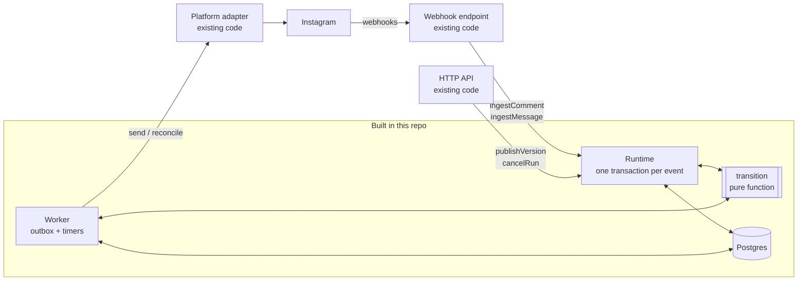
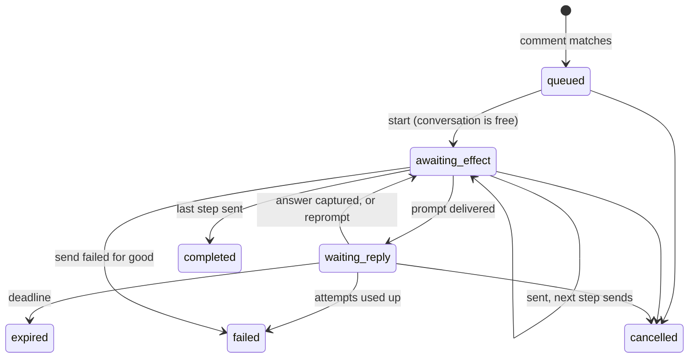
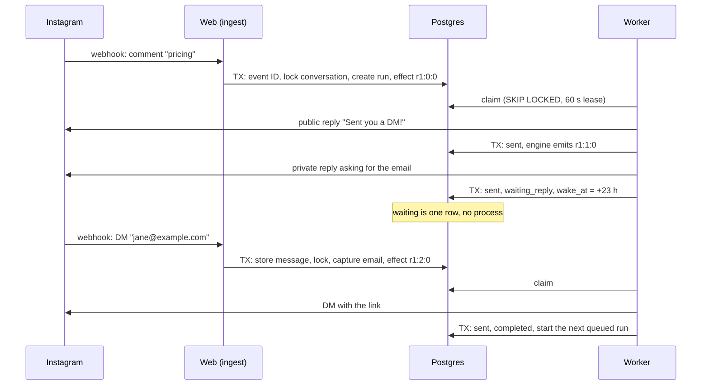

# Comment-triggered automations: backend design

> When someone comments "pricing" on any Instagram post: reply "Sent you a DM!", DM them asking for their email, wait for the answer, then DM a link.

This is the system design for that feature, with a reference implementation of the parts where the reasoning is easiest to get wrong.

## The design in one minute

- **Running four steps in order is not the problem.** Two properties of the platform are: a typed reply does not say which question it answers, and a send cannot be safely repeated. The design is organised around those two.
- **Postgres is the only moving part.** A run is a row. A state change and the message it causes commit in one transaction. No queue, no workflow engine, nothing new to operate for a team of three.
- **The behaviour of a run is one pure function.** `transition(definition, run, event, now)` does no I/O and never throws, so it is tested with thousands of random inputs and every failure replays from a seed.
- **Concurrency is handled per conversation.** One lock per (account, commenter) orders comments, replies, send results and timeouts. One run owns a conversation at a time; others queue.
- **Delivery is decided per kind of message.** A duplicate public comment and a duplicate link do not cost the same, so they do not get the same guarantee.
- **Every decision has its price written next to it** ([section 3](#3-decisions-and-what-each-one-costs)), and every claim that can be tested is tested. A randomized simulation found two real bugs in code that already passed 216 tests ([section 10](#10-what-the-tests-found)).

The brief asks for a design, not code. The code is here because "a reply racing a timeout is safe" is cheap to write and easy to get wrong.

**What is in this repo**

| | |
|---|---|
| This file | The design: scope, architecture, interfaces, data model, execution model, reliability, concurrency, trade-offs |
| [`docs/failure-modes.md`](docs/failure-modes.md) | Every failure and race considered, what the system does, and the test that proves it |
| [`docs/capacity.md`](docs/capacity.md) | Load estimates by stage, spikes, and what changes when |
| [`docs/testing.md`](docs/testing.md) | The invariants checked, the two bugs the simulation found, and the mutation results |
| [`src/`](src) | About 2,200 lines of TypeScript and SQL: the pure engine, the Postgres schema and store, the runtime |
| [`test/`](test) | 239 tests: unit, property, scenario, randomized simulation, and real-Postgres concurrency |
| [`AI-USAGE.md`](AI-USAGE.md) | What I did myself and where I used AI |

```bash
npm install
npm test                      # everything that does not need a database
docker compose up -d          # Postgres 15 on localhost:54329
DATABASE_URL=postgres://postgres@localhost:54329/automations_test npm test
```

## 1. Scope

**What the system must do**

- Start an automation when a comment matches a keyword.
- Reply publicly, send DMs, ask a question and wait for the answer, capture an email, reprompt, time out.
- Let a customer edit an automation without breaking conversations already in progress.
- Cancel a run.

**What it must guarantee**

- A process crash never loses a lead.
- A public comment is never posted twice.
- Waiting a day for a reply costs nothing but a row.
- One customer's viral post does not slow anyone else down.
- "Why didn't it fire for this comment?" is answered by a query.

**What is taken as given**, as the brief allows: receiving webhooks and verifying them, the Instagram client that replies and sends, HTTP routes, auth and UI. The design needs exactly two calls from that existing code ([section 5](#5-interfaces)).

**What is deliberately left out of the automation model**: branching, delays, HTTP steps, scripting ([section 6](#6-the-automation-model-and-how-general-it-is)).

## 2. What is actually hard here

**A typed reply carries no correlation ID.** For an ordinary text message the webhook says "account A received text T from user U", with a message ID and nothing else. Nothing ties it to the automation that asked the question. So the link between a reply and a waiting run has to be inferred, and the inference breaks whenever two runs could plausibly own the same reply, when the reply arrives before we have recorded that we are waiting, or after we gave up.

The platform does give a link in two narrower cases: a swipe-to-reply carries the ID of the message it answers (`reply_to.mid`), and a tapped quick reply or button returns a payload we chose. An email address is typed, so the example cannot rely on either. The reference code does not read these signals; when present they should override the inference, and that is an extension to `ingestMessage`, not a change to the model.

**Sending is not idempotent.** Meta's send endpoint documents no idempotency key. A call that times out, or a worker that dies between the call and the commit, leaves us not knowing whether the commenter got the message. Retrying may send twice. Not retrying may send nothing. No amount of careful queueing removes that choice; it can only be made deliberately, per kind of message.

If the sending layer that already exists in the product deduplicates on its own, this gets simpler, not different: every message kind becomes safe to retry, which is one table in [`src/core/types.ts`](src/core/types.ts) (`DELIVERY_POLICY`).

**Platform rules that shape the design.** Checked against Meta's documentation in November 2026; links in [`docs/capacity.md`](docs/capacity.md).

| Rule | Consequence |
|---|---|
| One private reply per comment (a DM addressed by comment ID), within 7 days | The first DM of a run is special. A definition that would need two is rejected at publish. A comment starts at most one run. |
| Ordinary DMs only inside 24 hours of the person's last message | The example waits 23 hours. The system cannot remind someone who never replied. Sources disagree on whether the private reply itself opens the window; this follows Meta's wording, which says the person must respond first. |
| 750 private replies per hour per account | The ceiling during a viral post is the platform, not our infrastructure. |
| Webhooks are redelivered, and sometimes never arrive | Event IDs are primary keys. Missed webhooks need a slow reconciliation poll (designed, not built). |

Everything else (durable waits, retries, webhook redelivery) is ordinary and solved with ordinary tools.

## 3. Decisions, and what each one costs

| Decision | Chosen over | Why | What it costs |
|---|---|---|---|
| **State lives in Postgres only** | Temporal; SQS + DynamoDB; Redis queues | The stack is already Postgres on Heroku and the team is small. A transition and its outgoing message commit in one transaction, which is the property the alternatives make you rebuild. | Workers poll, even when idle. Everything shares one primary. Revisit when peak writes reach thousands of rows a second ([capacity](docs/capacity.md)). |
| **Explicit state machine, pure `transition`** | Workflow-as-code with replay | A run is a short linear program that mostly waits. A pure function over data can be tested exhaustively and read in one sitting, with no determinism rules and no code-versioning problem. | No arbitrary code inside an automation. A new step type is a change to the engine. |
| **The conversation is the unit of concurrency** | Row locks per run; optimistic versions | A reply is addressed to a conversation, not a run, so that is where exclusion has to be. One lock, taken first, orders triggers, replies, send results and timers. | The lock is advisory: it lives in code, not in the schema. Unique indexes back it up, and a test skips the lock on purpose to prove they do. |
| **One active run per conversation; others queue** | Fan the reply out to every waiting run; "most recent question wins" | Fan-out makes one message answer two questions. "Most recent wins" silently starves the older run. Queueing is the only option where the commenter sees a normal conversation, and they are asked for their email once. | Head-of-line blocking per person: a second automation waits for the first to end, up to 23 hours if the person stays silent, while its own comment's 7-day private-reply clock runs. |
| **Delivery guarantee per message kind** | One global at-least-once or at-most-once | A duplicate public comment looks broken to everyone reading the post. A lead who gave an email and got nothing is a lost customer. These are different costs. | The link can arrive twice. A public reply can go missing and be recorded as "assumed sent". Both are stated, and the duplicate has a test that asserts it. |
| **A comment starts at most one run** | Start every automation that matches | A comment has one private reply to give. Two runs sharing it is the first bug the simulation found. | "pricing and a demo please" triggers one automation, the first by ID. The other is reported as `comment_taken`, not run. |
| **Versioned JSON, linear steps** | Graph for a visual builder; embedded scripting | Linear covers the product today. The document is small enough for a customer's agent to write over the API and is checked like a program at publish. | No branching and no delays. "If they don't answer, do something else" cannot be expressed yet. |
| **One `ask` step** | Separate `send_dm` and `wait`, as the brief lists them | A wait with no question has nothing to correlate a reply with, and "skip if we already know their email" must skip the question too. | One step type carries six options. |
| **Polling workers with leases** | LISTEN/NOTIFY; a message broker | Workers hold no state. A dead worker needs no operator: its rows are reclaimed when the lease expires. | A dead worker's message waits up to 60 seconds. A platform call must finish inside its lease, so the adapter's request timeout has to be shorter. |
| **Reactive throttling** | A proactive token bucket per account | The limit is told to us by the platform, so it cannot go stale in our config. | We find the limit by hitting it. The token bucket is designed and is the next thing to build. |

## 4. Architecture



- **Ingest** does the minimum inside the webhook request: record the event ID (redeliveries stop here), find matching automations, create runs. One transaction, then 200.
- **`transition`** is the whole behaviour of a run: `(definition, run, event, now) → (run', effect?)`. It performs no I/O, never throws, and returns the same run untouched for any event that does not apply. That last property is what makes duplicates and late arrivals harmless.
- **The worker** claims due messages from the outbox with `FOR UPDATE SKIP LOCKED`, calls the platform with no transaction open, records the result, and feeds it back to the run as an event. It also fires due timers.
- **The adapter** is the seam to the existing sending code.

Three ideas hold this together:

1. **A run is a row.** No process, in-memory timer or connection exists per run. Nothing is held in process memory between transactions, so any number of web and worker dynos can run this.
2. **Transactional outbox.** The state change and the intent to send are atomic. The send itself happens later, outside any transaction, so a slow platform never holds a database lock.
3. **Deciding is separate from doing.** The engine decides what should happen and returns it as data. The runtime persists it and talks to the world. Step rules can be read without thinking about races, and races are handled in one place.

## 5. Interfaces

**What this needs from the existing code**: two calls ([`src/runtime/adapter.ts`](src/runtime/adapter.ts)).

| Call | Returns |
|---|---|
| `send(effect)` | `ok` with the platform's message ID; `retryable` (optionally rate-limited, with retry-after); `permanent` (DMs blocked, comment deleted, token revoked); `already_sent` (the platform says this exact send already happened). If the call throws, the outcome is unknown and the delivery policy decides. |
| `reconcile(effect)` | `sent`, `not_sent` or `unknown`: a best-effort check of whether a send with an unknown outcome arrived, by echo webhook or by listing a comment's replies. `unknown` exists on purpose; the platform cannot always tell, and the system has to have an answer for that case. |

**What this exposes to the existing code**: five calls ([`src/runtime/runtime.ts`](src/runtime/runtime.ts)). Each returns a tagged result, never an exception for an expected case: a redelivered webhook is a normal outcome and the caller sees it as one.

| Call | Called by | Results |
|---|---|---|
| `publishVersion(version)` | The API, when a customer saves an automation | `published`, or `invalid` with errors that name the step |
| `ingestComment(comment)` | The webhook endpoint | `duplicate`, `no_match`, or `matched` with one of `created`, `already_triggered`, `cooldown`, `comment_taken` per automation |
| `ingestMessage(message)` | The webhook endpoint | `echo`, `duplicate`, `unmatched` (left for the human inbox), or `delivered` with whether a run consumed it |
| `cancelRun(runId, reason)` | The API | `cancelled`, `already_ended`, `not_found` |
| `tick()` | The worker loop | A report: effects sent, failed, retried, deferred, in doubt; timers fired |

**Inside**, persistence is one contract ([`src/store/store.ts`](src/store/store.ts)) with two implementations, Postgres and in-memory, that pass the same 40 tests. The in-memory store is a second implementation, not a mock, which is why the simulation that runs on it can be trusted.

## 6. The automation model, and how general it is

An automation is a trigger and an ordered list of steps ([`examples/pricing.json`](examples/pricing.json)):

```json
{
  "trigger": { "type": "comment_keyword", "platform": "instagram",
               "keywords": ["pricing"], "match": "contains", "postIds": "any" },
  "steps": [
    { "type": "reply_to_comment", "text": "Sent you a DM!" },
    { "type": "ask", "prompt": "What's the best email to send it to?",
      "capture": "email", "saveAs": "email", "timeoutSeconds": 82800,
      "maxAttempts": 3, "repromptText": "I couldn't spot an email in that. Could you send it again?",
      "skipIfKnown": true },
    { "type": "send_dm", "text": "Thanks! Here is the link: https://example.com/pricing" }
  ]
}
```

Three step types: `reply_to_comment`, `send_dm`, `ask`. That is deliberately all.

**How general, and why.** General enough that the next ten automations a customer asks for are new JSON, not new code: different keywords, different texts, several questions in a row, captured fields reused in later messages (`{{email}}`). Not general enough to be a workflow product: no branching, no delays, no HTTP steps, no scripting. Each of those is a real feature with its own failure modes, and none is needed to ship the example. The extension points are already in the shape of the code:

- A new step type is one case in `advance()` in the engine and one schema entry.
- A new trigger (story reply, new follower) is a new `matchesTrigger` variant; runs do not care what started them.
- Branching would replace "next step is `i + 1`" with a `next` field. The run already stores a step index, so in-flight runs survive that change.

**Definitions are data, and are checked like programs.** Because a comment has one private reply and ordinary DMs need the person to have written back, `[send_dm, send_dm]` can never work: the platform would reject the second message. The validator runs a small abstract interpretation over the steps, tracking the reachable set of `(privateReplyUsed, windowOpen)` states and forking at every `ask` that may be skipped. A definition is accepted only if no path needs a second private reply, so an invalid program is rejected when it is published, not when it runs. A property test then checks the engine against the validator: for any accepted definition and any event sequence, the engine never emits a second private reply.

This is also why `ask` is one step. In the first draft the question and the wait were separate, and `skipIfKnown` on the wait meant the question was still sent, used up the one private reply, and the link could never be delivered. Merging them removed the bug by construction.

**Versions are immutable.** Editing an automation publishes a new version. A run is pinned to the version it started on, so an edit can never move the step index of a running conversation onto a different step.

## 7. Data model

Full DDL with a comment on every index: [`src/store/schema.sql`](src/store/schema.sql).

| Table | What it holds | Invariant enforced by the database |
|---|---|---|
| `automation_versions` | Immutable published definitions | |
| `inbound_events` | Webhook event IDs already processed | Primary key: a redelivery inserts nothing |
| `runs` | One execution for one commenter: status, step index, captured fields, deadline | Unique `(account, trigger comment)`: **a comment starts at most one run**. Partial unique `(account, contact)` where status is active: **one owner per conversation** |
| `messages` | Every inbound DM, with which run consumed it (or none) | Primary key on the platform message ID |
| `effects` | The outbox and the permanent ledger of every send | Primary key is the idempotency key `run:step:attempt` |
| `account_throttles` | "Do not send for this account before T" | Only ever moves later |
| `leads` | Captured fields per contact (PII) | |
| `run_log` | Append-only story of each run | |

Timers are a column. A waiting run is a row with a `wake_at` and an entry in a partial index; there is no scheduler to keep alive.

The application takes a lock before it relies on any of these invariants. The indexes are the backstop for the day someone writes a code path that forgets to, and there is a test that skips the lock on purpose and checks that the index catches it.

`run_log` exists because the first support question for this feature will be "why didn't it fire for this comment?", and the answer should be a query, not an investigation.

## 8. Execution model



The example, end to end:



No transaction is open during a platform call. A crash can therefore only fall between a send and the transaction that records it, and every crash window has the same shape: the platform did something we have not recorded yet. The delivery policy below is the answer to exactly that.

**One transaction per event.** Lock the conversation, load the run, apply `transition`, save the run, append the log, insert the outgoing message into the outbox, commit.

**One message in flight per run.** The engine emits at most one effect per transition and the run waits for its result. Steps therefore execute strictly in order, and "which send failed" is never ambiguous.

**Waiting costs nothing.** A reply and a timeout are two events through the same locked transition: whichever commits first moves the run, and the other finds a run it no longer applies to and does nothing.

**Correlating replies.** Every inbound DM is stored first, unconsumed. If the conversation has an active run that is waiting, it consumes the message. If the run is not waiting yet (the person answered faster than the platform acknowledged our question), the message stays unconsumed, and the moment the run enters `waiting_reply` it drains unconsumed messages received since it started. Arrival order stops mattering. One distinction is kept: a stored message written before the question was enqueued ("hi", sent while the public reply was going out) is used only if it plainly contains the answer, such as an email sent unprompted. Otherwise it is not a failed attempt; it stays unconsumed and the person is not told "that is not an email" about a question they had not seen. If no run owns the conversation, the message is left for the human inbox.

**A second automation for the same person** is created `queued`. When the owner finishes, the next queued run is promoted in the same transaction. If it would ask for something we now know, `skipIfKnown` skips the question and its link goes out as that comment's private reply.

**Delivery policy per message kind.** When the outcome of a send is unknown:

| Message | Policy | Behaviour | Reason |
|---|---|---|---|
| Private reply (first DM) | `retry_safe` | Retry. "Already replied to this comment" counts as success. | The platform allows exactly one per comment, so it deduplicates for us. |
| Public comment reply | `at_most_once` | Never blindly retried. Reconcile against the platform; if still unknown, assume sent. | Two identical public replies look broken to everyone reading the post. A missing "Sent you a DM!" costs nothing. |
| Later DMs (the link) | `at_least_once` | Retry with backoff. | A duplicate link is a small annoyance. A lead who gave their email and got nothing is a lost customer. |

The system is therefore honest about being at-least-once for the link, and there is a test that asserts the duplicate rather than pretending it cannot happen. Removing it for real needs an idempotency key from the sending layer, or reconciliation through message echo webhooks, which is the next thing to add. Messenger documents a `metadata` string that is passed from the send call to the echo; I have not confirmed that Instagram echoes carry it.

Failures also differ by step: a failed public reply is logged and the run continues, because a courtesy comment must not cost the lead. A DM that fails for good ends the run.

## 9. Reliability and concurrency

The complete list, with the test for each row, is in [`docs/failure-modes.md`](docs/failure-modes.md). The short version:

- **Webhooks arrive more than once, late, or not at all.** Event IDs and message IDs are primary keys. Missed message webhooks are a known Instagram problem, so production needs a slow reconciliation poll of the conversations API per account with waiting runs (designed, not built).
- **A worker dies mid-send.** The outbox row stays `sending` with a lease. When the lease expires another worker claims it, sees that a previous attempt may have reached the platform, and applies the policy above.
- **Two workers, one message.** `SKIP LOCKED` hands each due row to one claimer. Settling re-checks the row under the conversation lock, and the engine ignores a result whose key is not the one the run is waiting on, so even a double settle changes nothing.
- **A worker holds a claim too long.** A batch is claimed under one lease and sent one message at a time. Before each send the worker checks its lease is still valid, and gives the message back if not. Every write back to the outbox is fenced on the attempt counter, so a slow worker cannot overwrite a newer claim.
- **The database fails under a worker.** One failed write does not stop the pass or the worker loop. The rest of the batch and the due timers are still processed, the error is reported, and the item that failed is in the same state as after a crash, so the same delivery policy recovers it.
- **Rate limits.** A rate-limit response throttles the whole account until the platform's retry-after, does not count against the message's attempts, and does not affect other accounts.
- **Permanent failures** (blocked DMs, deleted comment, revoked token) end the run with the platform's code in the log, and free the conversation for the next queued run.
- **Our own reply re-triggering the automation.** "Sent you a DM!" comes back as a comment webhook. Comments authored by the account never match.
- **The same person commenting five times.** One run per comment, plus a per-automation cooldown per contact.
- **One comment matching two automations.** Only one starts; the other is reported as `comment_taken`.

**How the concurrency claims are tested.** Three layers:

1. *Property tests on the engine*: for random valid definitions and random event sequences (stale keys, reordered timers, repeated starts), the engine never throws, never mutates, never repeats an effect key, never moves backwards, and terminal states absorb everything.
2. *Simulation of the whole runtime*: 1,000 random sequences per run of comments, replies, redeliveries, platform faults, clock jumps, cancellations, overlapping calls, and crashes injected before and after commit, against a fake platform that enforces Instagram's rules. Fifteen invariants are checked after every action, and at the end of every sequence the system must drain to a state where every run has ended. Fully deterministic, so a failure replays from its seed.
3. *Real Postgres, real connections*: 200 concurrent webhooks with duplicates and four concurrent workers; thirty comments from one person at once; replies racing timers. Every message delivered exactly once, runs of one conversation never interleave, and each run ends either completed or expired, never both.

The fake platform refuses what Instagram would refuse: a second private reply to a comment, and a DM to someone who has not written. A test cannot pass by doing something the real platform would reject.

## 10. What the tests found

Two bugs, both in code that passed every hand-written scenario. Details and the mutation table are in [`docs/testing.md`](docs/testing.md).

**One comment, two automations.** A comment matching two automations started two runs. The first used the comment's private reply. When the second run's turn came, its first DM was also a private reply to the same comment; the platform answered "already sent", and the `retry_safe` policy read that as success. The run carried on, waiting for an answer to a question the person never received. The cause was a design error, not a slip: uniqueness had been defined per (automation, comment), but the platform's budget is per comment. The fix is the rule "a comment starts at most one run", now a unique index and not only application logic.

This is also the limit of `retry_safe`: "already sent" means success only if nothing else can spend that comment's private reply. A person on the customer's team replying privately by hand still can.

**A lease that covers a batch.** A worker claims twenty messages under one sixty-second lease and sends them in turn. If an early send is slow, the lease expires, a second worker reclaims the rest, reconciles and sends them. The first worker then reaches the same messages and, believing its claim is fresh, sends them again without reconciling: a second public reply, which is exactly what `at_most_once` promises will not happen. The fix is a lease check before every send.

To check that the tests can fail, twenty-one bugs were introduced into the source one at a time. The simulation caught nineteen, one of them only in about four runs out of ten, so that one also has a deterministic test. The remaining two are caught by the engine's own tests; the testing doc explains why the simulation cannot see them.

## 11. Capacity

Load figures are assumptions; the method and the points where the design changes are what matter. Full working in [`docs/capacity.md`](docs/capacity.md).

One run of the example costs about 8 transactions, 25 row writes and 3 platform calls. A waiting run costs one row.

| Stage | Accounts using it | Runs / day | Row writes at peak | What changes |
|---|---|---|---|---|
| Today | 1,000 | 50,000 | 150 / s | Nothing in the design. One Postgres. Worker count is set by sends, not writes: see below. |
| 10× | 10,000 | 500,000 | 1,500 / s | Partition the log tables by month. Same shape. |
| 100× | 100,000 | 5,000,000 | 15,000 / s | Take the run log off row-by-row writes, put webhook ingest behind a queue, shard by account. |

**Sends are the tighter limit, not writes.** A worker sends one message at a time, so its throughput is one platform call's latency: about 3 sends a second if a call takes 300 ms (an assumption). Today's stage averages under 2 sends a second and peaks near 17, so two workers cover the average and the peak needs about six, or sends made concurrently inside a worker. Adding workers needs no change (`SKIP LOCKED`, tested with four at once); concurrent sends inside one worker are not built.

Sharding by account is mechanical: every query and every lock is already scoped to an account or a conversation, and no transaction spans two accounts. A workflow engine is not needed at any of these stages.

**Spikes.** A reel with 100,000 matching comments in an hour takes more than five days to answer at 750 private replies an hour, whatever is built. During a spike the system absorbs (one small transaction per comment), paces (throttle per account), stays fair (the outbox skips throttled accounts, so one backlog never delays another customer), and should tell the customer how long the backlog is (not built).

## 12. Built, and not built

| Built and tested | Designed here, not built |
|---|---|
| Definition schema and validator | Webhook endpoint and signature verification (assumed to exist) |
| Pure engine | The real Instagram adapter (assumed to exist) |
| Postgres schema and store, in-memory store, one contract suite for both | Proactive per-account token bucket (today: reactive throttle on rate-limit errors) |
| Runtime: ingest, outbox worker, timers, crash recovery, queueing, cancel | Reconciliation poll for missed webhooks |
| Fake platform that enforces the private-reply and messaging-window rules | Backlog ordering and shedding policy for spikes |
| Randomized simulation with crash injection; Postgres concurrency tests | A request timeout below the lease in the adapter |
| | Concurrent sends inside one worker (today: one at a time, scale by adding workers) |
| | Reading `reply_to.mid` and button payloads when the platform provides them |
| | Retention and partitioning of `run_log`, `messages`, `inbound_events` |
| | Token refresh, account pause and customer notification on revoked access |

Known gaps in what is built, in order of concern, are listed at the end of [`docs/failure-modes.md`](docs/failure-modes.md). The first is a platform call that outlasts its lease.

## 13. Open product questions

These are decisions to make with whoever owns the product, not alone:

1. **Order of the first two steps.** The brief replies "Sent you a DM!" before sending the DM. If the DM then fails (the person blocks DMs from businesses), the public reply is untrue. The engine runs steps in whatever order the definition gives; I would default new automations to DM first.
2. **Spike ordering.** With a backlog of matched comments and 750 sends an hour, newest-first probably converts better and oldest-first loses fewer to the 7-day limit.
3. **A human in the thread.** If someone on the customer's team replies manually while a run is waiting, the run should probably stand down. That needs the echo webhook and a policy.
4. **One comment, several automations.** Today the first match by automation ID wins and the rest are skipped. The customer should probably choose a priority, or be warned at publish time that two automations overlap.
5. **Queueing behind a silent person.** A second automation waits for the first to end. Automations that ask nothing have no reason to wait and could bypass the queue.
6. **Non-answers.** "What is this for?" is not an email. Today that is a reprompt and eventually `no_valid_reply`. It is also exactly the moment a person or an LLM should take over.
